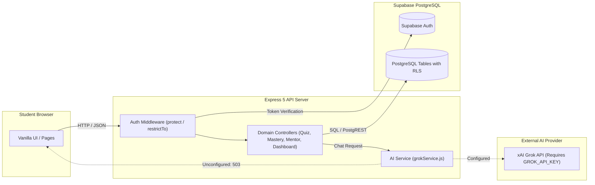

# EduSetu

> "Don't just answer the question — diagnose the gap."

EduSetu is an AI-powered diagnostic and multilingual learning platform engineered to bridge educational gaps across India. Built on a diagnostic-first philosophy, the system identifies the specific cognitive misconceptions behind student errors, visualizes knowledge dependencies through an interactive concept mastery graph, and delivers adaptive pedagogical tutoring across vernacular languages.

[](https://nodejs.org/)
[](https://expressjs.com/)
[](https://supabase.com/)
[](https://supabase.com/)
[](package.json)
[](#current-status-and-roadmap)

---

## Table of Contents

- [About EduSetu](#about-edusetu)
- [Key Features](#key-features)
- [Technology Stack](#technology-stack)
- [Architecture](#architecture)
- [Project Structure](#project-structure)
- [Getting Started](#getting-started)
- [Environment Variables](#environment-variables)
- [API Reference](#api-reference)
- [Database and Security](#database-and-security)
- [Testing](#testing)
- [Current Status and Roadmap](#current-status-and-roadmap)
- [Contributing and License](#contributing-and-license)

---

## About EduSetu

In rural and semi-urban Indian educational contexts, students encounter severe barriers: acute teacher shortages, high pupil-to-teacher ratios, and language obstacles in STEM subjects. Conventional learning software presents static video catalogs that report binary outcomes ("Correct" vs. "Incorrect") without diagnosing the underlying conceptual failure.

EduSetu replaces passive video consumption with an active diagnostic loop:
1. **Misconception Diagnosis**: Evaluates each incorrect answer against a rubric of known student pitfalls (e.g., inverted sign, reciprocal confusion, omitted constant) to explain *why* the error occurred.
2. **Concept Mastery Mapping**: Models subjects as directed dependency networks where topics transition across verified competency states.
3. **Multilingual Pedagogy**: Guides learners using Socratic dialogue in Hindi, Hinglish, and English calibrated to the student's grade level.
4. **Early Intervention**: Equips educators and mentors with actionable diagnostic briefs before accumulated gaps cause student disengagement.

---

## Key Features

### Implemented Features

- **Diagnostic Quizzes** (`quiz.html`): Concept-level assessments evaluated by the backend (`POST /api/quizzes/:id/attempt`). Wrong options are tagged with specific cognitive misconception identifiers, recording granular results in database audit tables.
- **Concept Mastery Map** (`mastery-map.html`): Interactive visual graph powered by `/api/mastery/map`. Visualizes prerequisites and student mastery states (`mastered`, `developing`, `shaky`, `unattempted`, `recommended`) with slide-out concept inspection drawers.
- **Student Dashboard** (`dashboard.html`): Consolidates overall confidence ratings, subject progress distributions, recent quiz attempts, and early dropout-risk indicators via `/api/dashboard/student`.
- **Subject and Topic Explorer** (`explore.html`): Curriculum navigation backed by `/api/subjects` and `/api/topics`, enabling search and grade-level filtering aligned with NCERT standards.
- **Mentor Dashboard** (`mentor.html`): Educator portal backed by `/api/dashboard/mentor` and `/api/mentor/students`. Displays linked student rosters, class-wide concept mastery summaries, and targeted revision recommendations.
- **Authentication System** (`login.html`, `register.html`): Full-stack authentication via Supabase Auth and Express session middleware, featuring a glassmorphism interface with a live blurred background.

### Partially Implemented Features

- **AI Tutor** (`chatbot.html`): Full backend integration architecture implemented in `backend/ai/grokService.js` calling the xAI Grok API (`POST /api/chat`) with conversation logging in the `ai_conversations` table. Requires a valid `GROK_API_KEY` in `.env`; responds with HTTP 503 configuration notice when unconfigured.
- **Personalized Learning Plan** (`learning-plan.html`): Functional client-side roadmap interface linking directly to quizzes, AI tutoring topics, and explorer modules. Dynamic server-side plan generation endpoint is planned.
- **Learning Community** (`community.html`): Interactive client-side interface for student discussion boards and study groups. Persistent database-backed community posting is planned.

---

## Technology Stack

| Layer | Technology | Details |
|---|---|---|
| **Frontend** | Vanilla HTML5, CSS3, JavaScript (ES6+) | No heavy UI frameworks; custom glassmorphism design system with CSS custom properties |
| **Backend** | Node.js (v18+), Express (v5.2.1) | Modular controller-service architecture, custom error handling, rate limiting |
| **Database** | Supabase (PostgreSQL) | 13 relational tables, foreign key constraints, JSONB diagnostic schemas |
| **Authentication** | Supabase Auth & JSONWebToken | Secure HttpOnly cookies (`sb-access-token`, `jwt`) and Bearer header support |
| **AI Integration** | xAI Grok API (`grok-3-mini` / `grok-beta`) | Socratic pedagogical system prompt with grade and language calibration |
| **Security & Utilities** | `@supabase/supabase-js`, `cookie-parser`, `dotenv` | Verified production dependencies from `package.json` |

---

## Architecture

The following diagram illustrates the request lifecycle through the EduSetu stack:



---

## Project Structure

```
EduSetu/
├── backend/
│   ├── ai/
│   │   └── grokService.js          # xAI Grok API integration & pedagogical prompt builder
│   ├── config/
│   │   ├── env.js                  # Environment variable loader
│   │   └── supabase.js             # Supabase client & admin client configuration
│   ├── controllers/
│   │   ├── authController.js       # Registration, login, session, and profile sync
│   │   ├── chatController.js       # Conversational AI session handler
│   │   ├── dashboardController.js  # Aggregated student metrics & dropout risk
│   │   ├── exploreController.js    # Subject and topic querying
│   │   ├── healthController.js     # Health check and database connectivity
│   │   ├── masteryController.js    # Concept mastery graph calculation
│   │   ├── mentorController.js     # Educator cohort analytics & student linkages
│   │   ├── profileController.js    # Student profile updates
│   │   └── quizController.js       # Diagnostic quiz retrieval & attempt evaluation
│   ├── middleware/
│   │   ├── auth.js                 # Authentication verification and role guards
│   │   └── rateLimit.js            # Express rate-limiting middleware
│   ├── routes/
│   │   ├── authRoutes.js           # /api/auth routes
│   │   ├── chatRoutes.js           # /api/chat routes
│   │   ├── dashboardRoutes.js      # /api/dashboard/student route
│   │   ├── exploreRoutes.js        # /api/subjects & /api/topics routes
│   │   ├── healthRoutes.js         # /api/health route
│   │   ├── index.js                # Master route aggregator
│   │   ├── masteryRoutes.js        # /api/mastery & /api/progress routes
│   │   ├── mentorRoutes.js         # /api/mentor & /api/dashboard/mentor routes
│   │   ├── profileRoutes.js        # /api/profile routes
│   │   └── quizRoutes.js           # /api/quizzes & /api/quiz-attempts routes
│   └── server.js                   # Express application entry point
├── frontend/
│   ├── assets/                     # Branded graphic assets and illustrations
│   ├── css/                        # Modular CSS stylesheets (theme, landing, app-shell, etc.)
│   ├── js/                         # Client-side JavaScript controllers and utilities
│   └── pages/                      # Application HTML templates
│       ├── index.html              # Landing page
│       ├── login.html              # Sign-in page
│       ├── register.html           # Sign-up page
│       ├── dashboard.html          # Student dashboard
│       ├── mastery-map.html        # Concept mastery graph
│       ├── chatbot.html            # AI tutor chat interface
│       ├── quiz.html               # Diagnostic quiz runner
│       ├── mentor.html             # Mentor oversight portal
│       ├── explore.html            # Curriculum explorer
│       ├── learning-plan.html      # Personalized study plan
│       ├── community.html          # Student learning community
│       ├── onboarding.html         # Diagnostic onboarding
│       └── profile.html            # Account preferences
├── supabase/
│   ├── migrations/
│   │   └── 20261006000000_initial_schema.sql # 13 tables, RLS policies, indexes, triggers
│   └── seed/
│       └── seed.sql                # NCERT curriculum seed data and test accounts
├── .env.example                    # Template for required environment variables
├── .gitignore                      # Git exclusion rules
├── package.json                    # Project metadata, dependencies, and run scripts
└── README.md                       # Platform documentation
```

---

## Getting Started

### Prerequisites

- **Node.js**: v18.0.0 or higher
- **npm**: v9.0.0 or higher
- **Supabase Account**: A free Supabase project with PostgreSQL database access

### Installation

1. **Clone the repository:**
   ```bash
   git clone https://github.com/tanishasamanta14/EduSetu.git
   cd EduSetu
   ```

2. **Install project dependencies:**
   ```bash
   npm install
   ```

3. **Configure environment variables:**
   ```bash
   cp .env.example .env
   ```
   Edit `.env` with your verified credentials (see [Environment Variables](#environment-variables)).

4. **Initialize database schema and seed data:**
   Execute the migration SQL file in your Supabase SQL Editor:
   - `supabase/migrations/20261006000000_initial_schema.sql`
   - `supabase/seed/seed.sql`

5. **Start the application:**
   ```bash
   npm start
   ```
   For active development:
   ```bash
   npm run dev
   ```

6. **Access the application locally:**
   - Landing Page: [http://localhost:5000/](http://localhost:5000/)
   - Sign In: [http://localhost:5000/pages/login.html](http://localhost:5000/pages/login.html)
   - Sign Up: [http://localhost:5000/pages/register.html](http://localhost:5000/pages/register.html)
   - Health Check: [http://localhost:5000/api/health](http://localhost:5000/api/health)

### Demo Credentials

When using the provided seed data (`seed.sql`), test accounts are available:

| Account Type | Email Address | Password | Permissions |
|---|---|---|---|
| **Student** | `student1@edusetu.in` | `Password123!` | Dashboard, Quizzes, Mastery Map, AI Tutor |
| **Mentor** | `mentor1@edusetu.in` | `Password123!` | Mentor Dashboard, Linked Student Insights |

---

## Environment Variables

The application reads configuration from `.env` via the `dotenv` package. Configure the following verified variables:

```env
# Server Configuration
PORT=5000
NODE_ENV=development
CLIENT_URL=http://localhost:5000

# Supabase Credentials (from Project Settings -> API)
SUPABASE_URL=https://your-project.supabase.co
SUPABASE_ANON_KEY=your-supabase-anon-key
SUPABASE_PUBLISHABLE_KEY=your-supabase-anon-key
SUPABASE_SERVICE_ROLE_KEY=your-supabase-service-role-key

# JWT Session Security
JWT_SECRET=your-secure-jwt-secret-string

# AI Provider Configuration (Optional for base platform; required for live AI responses)
GROK_API_KEY=your-xai-grok-api-key
GROK_MODEL=grok-3-mini
```

> [!CAUTION]
> The `.env` file contains sensitive API keys and database service credentials. Never commit `.env` to version control. The repository `.gitignore` explicitly excludes `.env`.

---

## API Reference

All backend API routes are prefixed with `/api`. Protected routes require a valid session via HttpOnly cookie (`sb-access-token` / `jwt`) or an `Authorization: Bearer <token>` header.

| HTTP Method | Route Path | Access | Purpose |
|---|---|---|---|
| `POST` | `/api/auth/register` | Public | Create new student or mentor profile |
| `POST` | `/api/auth/login` | Public | Authenticate user and issue session cookies |
| `GET` / `POST` | `/api/auth/logout` | Public | Terminate session and clear authentication cookies |
| `GET` | `/api/auth/me` | Protected | Fetch authenticated user profile data |
| `GET` | `/api/auth/dev-login` | Public | Fast-path developer login as demo student |
| `GET` | `/api/auth/dev-login-mentor` | Public | Fast-path developer login as demo mentor |
| `GET` | `/api/profile` | Protected | Retrieve full student profile and preferences |
| `PUT` | `/api/profile` | Protected | Update student profile metadata (name, grade, language) |
| `GET` | `/api/quizzes` | Protected | List active quizzes with topic filtering |
| `GET` | `/api/quizzes/:id` | Protected | Retrieve quiz details and assessment questions |
| `POST` | `/api/quizzes/:id/attempt` | Protected | Submit quiz answers; evaluates misconception tags and updates mastery |
| `GET` | `/api/quiz-attempts` | Protected | List user's past quiz attempt history |
| `GET` | `/api/quiz-attempts/:id` | Protected | Retrieve specific attempt with evaluated misconception tags |
| `GET` | `/api/mastery` | Protected | Fetch student's individual topic mastery records |
| `GET` | `/api/mastery/map` | Protected | Retrieve full concept graph (nodes, edges, prerequisites, states) |
| `GET` | `/api/progress` | Protected | Fetch student's overall confidence and subject progress |
| `GET` | `/api/dashboard/student` | Protected | Fetch aggregated metrics and dropout risk data for student |
| `GET` | `/api/dashboard/mentor` | Protected (Mentor) | Fetch cohort analytics, class mastery levels, and risk alerts |
| `GET` | `/api/mentor/students` | Protected (Mentor) | List all students linked to the authenticated mentor |
| `POST` | `/api/mentor/students` | Protected (Mentor) | Link a student to the authenticated mentor |
| `POST` | `/api/chat` | Protected | Submit message to AI tutor (requires `GROK_API_KEY`) |
| `GET` | `/api/chat/conversations` | Protected | List user's conversational session history |
| `GET` | `/api/chat/conversations/:id`| Protected | Fetch message history for a specific conversation |
| `DELETE`| `/api/chat/conversations/:id`| Protected | Delete a conversation session |
| `GET` | `/api/subjects` | Public | Retrieve active curriculum subjects |
| `GET` | `/api/topics` | Public | Retrieve curriculum topics with grade and subject filters |
| `GET` | `/api/topics/:id` | Public | Retrieve specific topic metadata and prerequisite links |
| `GET` | `/api/health` | Public | System health check and database connectivity probe |

---

## Database and Security

The platform database is structured across **13 relational tables** in PostgreSQL managed through Supabase:

1. `profiles`: User accounts linked to `auth.users`, storing role (`student`, `mentor`, `admin`), grade level, and language preference.
2. `subjects`: Academic subjects (Mathematics, Science, English, etc.) with grade-level calibration.
3. `topics`: Specific curriculum units linked to subjects.
4. `topic_prerequisites`: Self-referencing junction table defining the directed acyclic graph for concept prerequisites.
5. `questions`: Diagnostic items with options stored as JSONB arrays containing tagged misconceptions.
6. `quizzes`: Quiz groupings referencing topics.
7. `quiz_questions`: Junction table mapping ordered questions to quizzes.
8. `quiz_attempts`: Audit log of user submissions, scores, and time-on-task.
9. `quiz_answers`: Individual question evaluations recording the selected option, correctness, and detected misconception tag.
10. `mastery`: Per-student topic mastery status (`mastered`, `developing`, `shaky`, `weak`, `recommended`, `unattempted`).
11. `learning_progress`: Aggregated student confidence ratings and subject progress percentages.
12. `ai_conversations`: Conversation sessions and message payloads exchanged with the AI tutor.
13. `mentor_students`: Relational linkages connecting mentors to their assigned students.

### Row Level Security (RLS)

- **RLS Enabled**: Enforced on all 13 database tables.
- **18 Explicit RLS Policies**: Ensure students can read and modify only their personal data (`auth.uid() = user_id`), while verified mentors can inspect data solely for assigned students (`mentor_students` linkage).
- **Public Reference Tables**: Subjects, topics, prerequisites, and quizzes allow public reads (`is_active = true`) while preventing unauthorized modifications.
- **Triggers**: Automated trigger `handle_updated_at` synchronizes timestamps across 10 tables; trigger `handle_new_user` handles profile creation upon Supabase Auth signup.

---

## Testing

The project's test command in `package.json` runs a system sanity verification:

```bash
npm test
```

Current test verification:
- **Server Health**: Probe `GET /api/health` returns `200 OK` confirming database connectivity.
- **API Functional Tests**: Verified through automated HTTP command probes (`curl` / PowerShell) covering:
  - Authentication flows (`/api/auth/login`, `/api/auth/register`, `/api/auth/dev-login`)
  - Error states (empty payloads return `400 Bad Request`, invalid credentials return `401 Unauthorized`)
  - Route availability across all static pages (`index.html`, `login.html`, `register.html`, etc.)

*Note: Automated unit and integration testing suites (e.g., Jest, Supertest) are scheduled for subsequent iterations.*

---

## Current Status and Roadmap

### Current Status

- **Database & Architecture**: Production schema deployed on Cloud Supabase with 13 tables, RLS, and seed data.
- **Core APIs**: Authentication, quizzes, misconception logging, concept mastery mapping, dashboard, and mentor endpoints are functional.
- **Frontend Views**: Core pages use a responsive, accessible glassmorphism theme with living blurred backdrops on authentication views.
- **Known Limitations**:
  - Live AI tutor answers require setting `GROK_API_KEY` in `.env`. Without it, `/api/chat` responds with HTTP 503 indicating configuration is pending.
  - No automated password recovery endpoint is currently wired to an external email delivery provider.

### Roadmap

- [ ] Automated integration test suite using Jest and Supertest.
- [ ] Offline caching via Service Worker (PWA) for low-connectivity environments.
- [ ] Speech-to-text input supporting Hindi and regional Indian dialects.
- [ ] Automated SMS/WhatsApp revision briefs for parents and guardians.
- [ ] Dynamic server-side learning plan generation engine.

---

## Contributing and License

### Contributing

Contributions are welcome. Please adhere to the following workflow:

1. Fork the repository on GitHub.
2. Create a focused feature branch:
   ```bash
   git checkout -b feature/diagnostic-enhancement
   ```
3. Commit verified changes:
   ```bash
   git commit -m "feat: add misconception tags for quadratic formulas"
   ```
4. Push to your branch:
   ```bash
   git push origin feature/diagnostic-enhancement
   ```
5. Open a Pull Request detailing the changes and test results.

### License

The project is licensed under the **ISC License** as specified in [`package.json`](package.json).

---

EduSetu — Empowering learners and educators across India through diagnostic intelligence.
