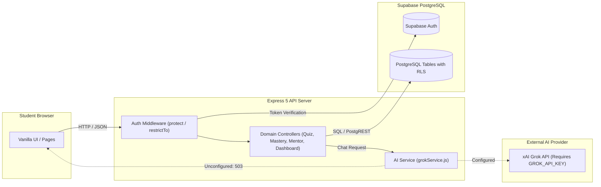

# 🎓 EduSetu


> *"Don't just answer the question — diagnose the gap."*

EduSetu is an intelligent, diagnostic-first learning platform built to bridge educational divides across India. Rather than presenting generic video catalogs, EduSetu diagnoses the root cognitive misconceptions behind student errors, visualizes knowledge dependencies through an interactive concept mastery graph, and delivers adaptive Socratic tutoring across vernacular languages.

[](https://nodejs.org/)
[](https://expressjs.com/)
[](https://supabase.com/)
[](https://supabase.com/)
[](package.json)
[](#-implementation-status--roadmap)

---

## 📑 Table of Contents

- [📖 About EduSetu](#-about-edusetu)
- [✨ Key Features](#-key-features)
- [🛠️ Technology Stack](#️-technology-stack)
- [🏗️ System Architecture](#️-system-architecture)
- [📁 Project Structure](#-project-structure)
- [🚀 Getting Started](#-getting-started)
- [🧪 Testing](#-testing)
- [🗺️ Implementation Status & Roadmap](#️-implementation-status--roadmap)
- [🤝 Contributing & License](#-contributing--license)

---

## 📖 About EduSetu

In rural and semi-urban learning ecosystems, students encounter systemic barriers: overcrowded classrooms, limited one-on-one attention, and steep language hurdles in STEM disciplines. Conventional learning platforms provide static video libraries that report binary outcomes (*"Correct"* vs. *"Incorrect"*), leaving students confused about why they made a mistake and educators unable to intervene in time.

EduSetu replaces passive video streaming with an active diagnostic loop:

- **Misconception Diagnosis**: Every distractor option in assessments is tagged with a specific cognitive pitfall (e.g., sign reversal, inverted fraction operation, omitted constant) to reveal the root cause of an error.
- **Concept Mastery Mapping**: Subjects are modeled as directed dependency networks where topics transition dynamically across verified competency states.
- **Multilingual Pedagogy**: Socratic guidance delivered in Hindi, Hinglish, and English, calibrated to the student's grade level.
- **Early Intervention**: Generates diagnostic briefs and dropout risk indicators for educators and guardians before academic gaps widen.

---

## ✨ Key Features

| Feature | Status | Description |
|---|:---:|---|
| 🎯 **Diagnostic Quizzes** | `Implemented` | Concept-level assessments evaluated by `/api/quizzes/:id/attempt`. Classifies specific cognitive misconceptions from student choices and logs attempts into granular database audit tables. |
| 🧠 **Concept Mastery Map** | `Implemented` | Dynamic dependency graph powered by `/api/mastery/map`. Visualizes topic prerequisites and student mastery states (`mastered`, `developing`, `shaky`, `unattempted`, `recommended`) with slide-out concept drawers. |
| 📈 **Student Dashboard** | `Implemented` | Centralized analytics dashboard via `/api/dashboard/student`. Displays live confidence ratings, subject progress distributions, recent quiz history, and early dropout-risk indicators. |
| 📚 **Subject & Topic Explorer** | `Implemented` | NCERT-aligned curriculum browser backed by `/api/subjects` and `/api/topics`. Supports search, grade-level filtering, and prerequisite inspection across core subjects. |
| 👨‍🏫 **Mentor Dashboard** | `Implemented` | Educator portal backed by `/api/dashboard/mentor` and `/api/mentor/students`. Delivers linked student rosters, cohort-wide concept health overviews, and targeted revision recommendations. |
| 🔐 **Authentication System** | `Implemented` | Production authentication via Supabase Auth and Express session cookies (`login.html`, `register.html`). Features a glassmorphism interface with living blurred landing scene backdrops. |
| 🤖 **AI Tutor** | `Partially Implemented` | Conversational Socratic tutoring engine in `backend/ai/grokService.js` calling the xAI Grok API (`POST /api/chat`). Stores sessions in database; requires setting `GROK_API_KEY` in `.env` (returns HTTP 503 configuration notice if unconfigured). |
| 🗺️ **Personalized Learning Plan** | `Partially Implemented` | Functional client-side roadmap interface (`learning-plan.html`) linking directly to quizzes, AI tutoring topics, and explorer modules. Dynamic server-side plan synthesis is planned. |
| 💬 **Learning Community** | `Planned` | Interactive client-side interface (`community.html`) for peer questions, upvoting, and study group discussions. Persistent backend discussion threads are planned. |

---

## 🛠️ Technology Stack

| Layer | Component | Description |
|---|---|---|
| **Frontend** | Vanilla Web Standards | HTML5, CSS3, ES6+ JavaScript. Custom glassmorphism design system using CSS custom properties with zero heavy UI framework overhead. |
| **Backend** | Node.js & Express | Node.js (v18+) running Express (v5.2.1) with modular controllers, services, middleware guards, and rate limiting. |
| **Database** | Supabase (PostgreSQL) | Managed PostgreSQL with 13 relational tables, foreign key constraints, JSONB diagnostic schemas, and 18 Row Level Security (RLS) policies. |
| **Authentication** | Supabase Auth & JWT | Secure session issuance using HttpOnly cookies (`sb-access-token`, `jwt`) with Bearer token header support. |
| **AI Integration** | xAI Grok API | Integrated Socratic tutor via `grokService.js` (model: `grok-3-mini` / `grok-beta`) with grade-calibrated prompts and vernacular localization. |
| **Libraries & Tooling** | Verified Dependencies | `@supabase/supabase-js` (v2.x), `cookie-parser` (v1.4.x), `dotenv` (v17.x), `jsonwebtoken` (v9.x). |

---

## 🏗️ System Architecture

The following diagram illustrates the request lifecycle through the EduSetu stack:



---

## 📁 Project Structure

```
EduSetu/
├── backend/
│   ├── ai/
│   │   └── grokService.js          # xAI Grok API integration & Socratic prompt builder
│   ├── config/
│   │   ├── env.js                  # Environment variable configuration
│   │   └── supabase.js             # Supabase client and service-role instances
│   ├── controllers/
│   │   ├── authController.js       # Auth, registration, login, and session sync
│   │   ├── chatController.js       # Socratic conversational session handler
│   │   ├── dashboardController.js  # Student performance metrics & risk indicators
│   │   ├── exploreController.js    # Subject and topic querying
│   │   ├── healthController.js     # System health and database connectivity probe
│   │   ├── masteryController.js    # Concept mastery calculation & graph generator
│   │   ├── mentorController.js     # Educator cohort analytics & student linkages
│   │   ├── profileController.js    # Learner profile updates
│   │   └── quizController.js       # Quiz retrieval & misconception evaluation
│   ├── middleware/
│   │   ├── auth.js                 # Session verification and role-based guards
│   │   └── rateLimit.js            # Request rate-limiting middleware
│   ├── routes/
│   │   ├── authRoutes.js           # /api/auth routes
│   │   ├── chatRoutes.js           # /api/chat routes
│   │   ├── dashboardRoutes.js      # /api/dashboard/student route
│   │   ├── exploreRoutes.js        # /api/subjects & /api/topics routes
│   │   ├── healthRoutes.js         # /api/health route
│   │   ├── index.js                # Master Express route aggregator
│   │   ├── masteryRoutes.js        # /api/mastery & /api/progress routes
│   │   ├── mentorRoutes.js         # /api/mentor & /api/dashboard/mentor routes
│   │   ├── profileRoutes.js        # /api/profile routes
│   │   └── quizRoutes.js           # /api/quizzes & /api/quiz-attempts routes
│   └── server.js                   # Application entry point & middleware mounting
├── frontend/
│   ├── assets/                     # Graphic assets, study illustrations, and icons
│   ├── css/                        # Modular style system (theme, landing, app-shell, etc.)
│   ├── js/                         # Client-side JavaScript controllers and utilities
│   └── pages/                      # Application views
│       ├── index.html              # Living landing page
│       ├── login.html              # Glassmorphic sign-in page
│       ├── register.html           # Glassmorphic sign-up page
│       ├── dashboard.html          # Student analytics dashboard
│       ├── mastery-map.html        # Interactive concept mastery map
│       ├── chatbot.html            # AI tutor chat interface
│       ├── quiz.html               # Diagnostic quiz runner
│       ├── mentor.html             # Mentor oversight portal
│       ├── explore.html            # Curriculum explorer
│       ├── learning-plan.html      # Personalized study plan
│       ├── community.html          # Student learning community
│       ├── onboarding.html         # Diagnostic onboarding
│       └── profile.html            # Account preferences
├── supabase/
│   ├── migrations/
│   │   └── 20261006000000_initial_schema.sql # 13 tables, RLS policies, indexes, triggers
│   └── seed/
│       └── seed.sql                # NCERT curriculum seed data and test accounts
├── .env.example                    # Template for required environment configuration
├── .gitignore                      # Git exclusion rules
├── package.json                    # Project metadata, dependencies, and run scripts
└── README.md                       # Master platform documentation
```

---

## 🚀 Getting Started

### Prerequisites

- **Node.js**: v18.0.0 or higher
- **npm**: v9.0.0 or higher
- **Supabase Project**: Free-tier project with PostgreSQL access

### Installation & Setup

1. **Clone the repository:**
   ```bash
   git clone https://github.com/tanishasamanta14/EduSetu.git
   cd EduSetu
   ```

2. **Install dependencies:**
   ```bash
   npm install
   ```

3. **Configure environment settings:**
   Copy the provided configuration template:
   ```bash
   cp .env.example .env
   ```
   Add your verified Supabase project credentials (`SUPABASE_URL`, `SUPABASE_ANON_KEY`, `SUPABASE_SERVICE_ROLE_KEY`) and session secret (`JWT_SECRET`) to `.env`. For live AI responses, supply a valid `GROK_API_KEY`.

4. **Initialize database schema and seed data:**
   Execute the migration SQL file in your Supabase SQL Editor:
   - `supabase/migrations/20261006000000_initial_schema.sql`
   - `supabase/seed/seed.sql`

5. **Start the application:**
   ```bash
   npm start
   ```
   For active development with auto-restart:
   ```bash
   npm run dev
   ```

6. **Open in browser:**
   - **Landing Page**: [http://localhost:5000/](http://localhost:5000/)
   - **Sign In**: [http://localhost:5000/pages/login.html](http://localhost:5000/pages/login.html)
   - **Sign Up**: [http://localhost:5000/pages/register.html](http://localhost:5000/pages/register.html)
   - **Health Probe**: [http://localhost:5000/api/health](http://localhost:5000/api/health)

### Test Credentials

When initialized with the provided seed data (`seed.sql`), test accounts are available:

| Account Type | Email Address | Password | Permissions |
|---|---|---|---|
| 🎓 **Student** | `student1@edusetu.in` | `Password123!` | Dashboard, Quizzes, Mastery Map, AI Tutor |
| 👨‍🏫 **Mentor** | `mentor1@edusetu.in` | `Password123!` | Mentor Dashboard, Linked Student Insights |

---

## 🧪 Testing

The test command in `package.json` executes a system sanity check:

```bash
npm test
```

Verification status:
- **Server Health**: Probe `GET /api/health` returns `200 OK` confirming database connectivity.
- **API Functional Tests**: Verified through automated HTTP command probes covering authentication flows (`/api/auth/login`, `/api/auth/register`), validation handling (empty submissions return `400 Bad Request`, invalid credentials return `401 Unauthorized`), and route availability across all static views.

---

## 🗺️ Implementation Status & Roadmap

### Current Implementation Status

- **Database & Architecture**: Production schema deployed on Cloud Supabase with 13 relational tables, 18 RLS policies, and seed data.
- **Core APIs**: Authentication, quizzes, misconception logging, concept mastery mapping, dashboard, and mentor endpoints are functional.
- **Frontend Views**: Core pages use a responsive, accessible glassmorphism theme with living blurred backdrops on authentication views.
- **Active Limitations**:
  - Live AI tutor responses require an active `GROK_API_KEY` in `.env`. If unconfigured, `/api/chat` responds with HTTP 503 indicating configuration is pending.
  - No automated password recovery endpoint is currently wired to an external email delivery provider.

### Roadmap

- [ ] Automated integration test suite using Jest and Supertest.
- [ ] Offline caching via Service Worker (PWA) for low-connectivity environments.
- [ ] Speech-to-text input supporting Hindi and regional Indian dialects.
- [ ] Automated SMS/WhatsApp revision briefs for parents and guardians.
- [ ] Dynamic server-side learning plan generation engine.

---

## 🤝 Contributing & License

### Contributing

Contributions are welcome. Please adhere to the following workflow:

1. Fork the repository on GitHub.
2. Create a focused feature branch:
   ```bash
   git checkout -b feature/diagnostic-enhancement
   ```
3. Commit verified changes:
   ```bash
   git commit -m "feat: add misconception tags for quadratic formulas"
   ```
4. Push to your branch:
   ```bash
   git push origin feature/diagnostic-enhancement
   ```
5. Open a Pull Request detailing the changes and test results.

### License

The project is licensed under the **ISC License** as specified in [`package.json`](package.json).

---

<p align="center">
  <strong>EduSetu — Empowering learners and educators across India through diagnostic intelligence.</strong>
</p>
