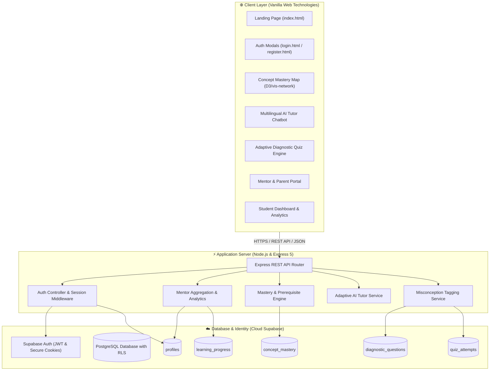

# 🎓 EduSetu — AI-Powered Diagnostic & Multilingual Learning Platform

<p align="center">
  
</p>

<p align="center">
  <strong>Bridging educational gaps across India through diagnostic-first, vernacular AI tutoring and interactive concept mastery visualization.</strong>
</p>

<p align="center">
  <a href="#-key-features"></a>
  <a href="#-technology-stack"></a>
  <a href="#-technology-stack"></a>
  <a href="#-technology-stack"></a>
  <a href="#-technology-stack"></a>
  <a href="#-license"></a>
</p>

---

## 📑 Table of Contents

- [🌟 Overview & Core Philosophy](#-overview--core-philosophy)
- [🧩 Problem Statement & Real-World Impact](#-problem-statement--real-world-impact)
- [✨ Key Features](#-key-features)
  - [🗺️ Concept Mastery Map](#️-concept-mastery-map)
  - [🏷️ Misconception Tagging Engine](#️-misconception-tagging-engine)
  - [🤖 Multilingual Vernacular AI Tutor](#-multilingual-vernacular-ai-tutor)
  - [👨‍🏫 Mentor & Educator Dashboard](#-mentor--educator-dashboard)
  - [📊 Predictive Analytics & Dropout Intervention](#-predictive-analytics--dropout-intervention)
  - [🎨 Glassmorphism Design System](#-glassmorphism-design-system)
- [🏗️ System Architecture](#️-system-architecture)
  - [📐 High-Level Architecture Diagram](#-high-level-architecture-diagram)
  - [🗂️ Project Directory Structure](#️-project-directory-structure)
  - [🗄️ Database & Security Architecture](#️-database--security-architecture)
- [💻 Platform Modules & Pages](#-platform-modules--pages)
- [🛠️ Technology Stack](#️-technology-stack)
- [🚀 Quick Start & Installation](#-quick-start--installation)
  - [Prerequisites](#prerequisites)
  - [Installation Steps](#installation-steps)
  - [Environment Configuration](#environment-configuration)
  - [Running the Platform](#running-the-platform)
- [🧪 Test Credentials & Demo Accounts](#-test-credentials--demo-accounts)
- [📡 API Reference](#-api-reference)
- [🎯 Future Roadmap](#-future-roadmap)
- [🤝 Contributing](#-contributing)
- [📄 License](#-license)

---

## 🌟 Overview & Core Philosophy

**EduSetu** (*Edu* + *Setu* / सेतु = Bridge) is an intelligent, diagnostic-first learning companion built around one uncompromising philosophy:

> **"Don't just answer the question — diagnose the gap."**

In standard learning apps, an incorrect response simply displays *"Incorrect — the right answer is B"*. Students are left wondering *what* went wrong, and educators are left without actionable insight. 

EduSetu disrupts this paradigm by analyzing the **underlying cognitive misconception behind each error**, charting the learner's journey across an **interactive concept dependency graph**, and providing **adaptive, vernacular explanations in Hindi, Hinglish, and English** that build authentic confidence.

---

## 🧩 Problem Statement & Real-World Impact

In rural and semi-urban educational ecosystems, learners confront systemic barriers:

1. **Shortage of Trained Teachers & High Pupil-Teacher Ratios**: Class sizes regularly exceed 50:1, leaving minimal bandwidth for individual attention.
2. **Language Gaps in STEM Subjects**: Technical textbooks rely on rigid English terminology, creating an artificial barrier for native regional language speakers.
3. **The Class 8 Dropout Spike**: Dropout rates climb steeply after Class 8 due to cumulative unaddressed foundational gaps, anxiety, and lack of timely intervention.
4. **Passive Content Libraries**: Existing platforms push pre-recorded video libraries rather than interactive, responsive diagnostic help.

### 🥊 How EduSetu Compares

| Learning Dimension | Conventional Ed-Tech Apps | 🌟 EduSetu Platform |
|---|---|---|
| **Content Delivery** | Static, pre-recorded video lectures | Adaptive AI dialogue tailored to learner's grade & pace |
| **Doubt Resolution** | Slow ticket-based queues or costly human tutors | Instant, step-by-step Socratic guidance in Hindi/English |
| **Error Diagnostics** | Binary correctness flag (Right / Wrong) | **Misconception Tagging Engine** classifying the root reason |
| **Visual Analytics** | Generic completion percentages | **Interactive Concept Mastery Map** (Skill Tree) |
| **Educator Role** | Disconnected or expensive premium add-on | **Integrated Mentor Portal** with auto-generated revision briefs |
| **Device Accessibility** | Bandwidth-intensive video streaming | Lightweight, fast-loading architecture with low-data support |
| **Growth Metric** | Addictive streaks & superficial badges | **Confidence Score Tracking** measuring verified comprehension |

---

## ✨ Key Features

### 🗺️ Concept Mastery Map
Instead of a flat list of scores, EduSetu models knowledge as a **dynamic dependency graph**:
- 🟢 **Mastered**: Concepts where the student demonstrates consistent 80%+ accuracy.
- 🟡 **Shaky**: Concepts showing recurring misconceptions that require targeted revision.
- ⚪ **Unattempted**: Foundational topics waiting to be explored.
- 🔵 **Recommended**: Next logical milestones based on prerequisite mastery.

Clicking any concept opens an instant diagnostic drawer with quick practice quizzes, concept visualization shortcuts, and direct AI tutor assistance.

### 🏷️ Misconception Tagging Engine
When taking quizzes in EduSetu, each distractor represents a known cognitive pitfall:
- **Sign Flipping Errors** (e.g., `-3x` treated as `+3x`)
- **Numerator / Denominator Confusion** in fraction arithmetic
- **Unit Conversion Missteps** in Physics
- **Chemical Equation Balancing Inversions** in Science

The engine categorizes the exact misstep, presents an immediate targeted clarification, and logs the pattern to the student's mastery profile.

### 🤖 Multilingual Vernacular AI Tutor
- Provides step-by-step Socratic hints without handing out answers directly.
- Full fluency across **Hindi**, **Hinglish**, and **English**.
- Real-time confidence feedback: after every explanation, learners self-rate (*"Got it!"*, *"Kind of"*, *"Still confused"*), adjusting subsequent explanations automatically.

### 👨‍🏫 Mentor & Educator Dashboard
- Designed specifically for teachers, tutors, and parents.
- Single-pane view of all linked learners with automated diagnostic notes (e.g., *"Aarav struggles with Algebraic Sign Rules — recommended 10-minute targeted review"*).
- Cohort-level mastery heatmaps identifying shared classroom bottlenecks before examination periods.

### 📊 Predictive Analytics & Dropout Intervention
- Identifies early warning indicators of disengagement (prolonged inactivity, sudden drops in confidence, repeated errors in gateway topics).
- Generates proactive remedial interventions before academic failure leads to withdrawal.

### 🎨 Glassmorphism Design System
- Modern dark-navy aesthetic (`#060913`, `#0A1020`) with warm golden accents (`#F59E0B`, `#FBBF24`).
- **Living Blurred Background Architecture**: Modals feature an authentic blurred view (`backdrop-filter: blur(5px)`) of the live platform, with 100% crisp foreground cards.
- Fully responsive across desktop workstations, tablets, and budget mobile browsers.

---

## 🏗️ System Architecture

### 📐 High-Level Architecture Diagram



### 🗂️ Project Directory Structure

```
EduSetu/
├── 📁 frontend/                     # Vanilla HTML, CSS, JavaScript Client
│   ├── 📁 assets/                   # Branded illustrations, vectors & study scenes
│   ├── 📁 css/                      # Modular style system
│   │   ├── theme.css                # Global design tokens, color palettes & typography
│   │   ├── landing.css              # Landing page styles & living background scenes
│   │   ├── app-shell.css            # Navigation, glass cards & shared components
│   │   ├── chatbot.css              # AI Tutor conversational UI
│   │   ├── dashboard.css            # Analytics charts & progress widgets
│   │   ├── mastery-map.css          # Interactive concept graph styling
│   │   └── quiz.css                 # Diagnostic assessment interface
│   ├── 📁 js/                       # Client-side controllers & interactive handlers
│   │   ├── auth.js                  # Client authentication helpers
│   │   ├── chatbot.js               # Chatbot logic & confidence feedback
│   │   ├── mastery-map.js           # Graph visualizer & prerequisite trees
│   │   ├── quiz.js                  # Adaptive quiz runner & misconception logic
│   │   ├── dashboard.js             # Student metrics visualizer
│   │   └── mentor.js                # Educator cohort aggregation
│   └── 📁 pages/                    # Complete application views
│       ├── index.html               # Living Landing Page
│       ├── login.html               # Glassmorphic Sign-In Page
│       ├── register.html            # Glassmorphic Sign-Up Page
│       ├── onboarding.html          # Diagnostic intake & profile setup
│       ├── dashboard.html           # Student progress dashboard
│       ├── mastery-map.html         # Interactive skill-tree concept map
│       ├── chatbot.html             # Multilingual AI doubt solver
│       ├── quiz.html                # Adaptive diagnostic quiz runner
│       ├── learning-plan.html       # Personalized learning roadmaps
│       ├── mentor.html              # Mentor / Teacher oversight portal
│       ├── explore.html             # Subject and topic curriculum browser
│       ├── community.html           # Peer collaboration & discussion forum
│       └── profile.html             # Learner preferences & account settings
│
├── 📁 backend/                      # Node.js & Express 5 API Server
│   ├── server.js                    # Express entry point & middleware mounting
│   ├── 📁 ai/                       # Diagnostic AI prompts & reasoning pipelines
│   ├── 📁 config/                   # Supabase client configurations
│   ├── 📁 controllers/              # Business logic controllers
│   │   ├── authController.js        # Supabase Auth, sessions & profile sync
│   │   ├── masteryController.js     # Prerequisite graphs & mastery state
│   │   ├── quizController.js        # Diagnostic questions & misconception tags
│   │   ├── chatController.js        # Vernacular AI chat orchestration
│   │   ├── dashboardController.js   # Student performance aggregation
│   │   └── mentorController.js      # Educator cohort metrics
│   ├── 📁 middleware/               # Auth guards (protect, role guards) & error handlers
│   ├── 📁 routes/                   # Clean Express REST route definitions
│   ├── 📁 services/                 # Core domain services & database queries
│   └── 📁 utils/                    # AppError, response formatters & helpers
│
├── 📁 supabase/                     # Database migrations & seed assets
│   ├── 📁 migrations/               # PostgreSQL schema & Row-Level Security policies
│   │   └── 20261006000000_initial_schema.sql
│   └── 📁 seed/                     # Seed datasets with curriculum & test students
│       └── seed.sql
│
├── .env.example                     # Environment template (safe for VCS)
├── .gitignore                       # Git exclusions
├── package.json                     # Project manifest & npm scripts
└── README.md                        # Master documentation
```

### 🗄️ Database & Security Architecture
EduSetu operates on a relational PostgreSQL schema hosted on **Cloud Supabase** with strict **Row-Level Security (RLS)**:
- `profiles`: User accounts, academic grades, vernacular language preferences, roles (`student`, `mentor`, `admin`).
- `subjects` & `topics`: NCERT-aligned academic taxonomy from middle school to college levels.
- `concepts`: Individual atomic competencies linked by prerequisite graphs.
- `concept_mastery`: Student-by-concept mastery levels (`mastered`, `shaky`, `unattempted`, `recommended`) with confidence weights.
- `diagnostic_questions`: Assessment items indexed with misconception tags on each distractor option.
- `quiz_attempts`: Detailed audit logs of answers, time-on-task, and tagged errors.
- `learning_progress`: Overall progress aggregates, subject competencies, and dropout-risk scorecards.

---

## 💻 Platform Modules & Pages

| Page Path | Module Name | Primary Function |
|---|---|---|
| [`/pages/index.html`](frontend/pages/index.html) | **Living Landing Page** | Platform overview, interactive feature demo, live statistics, curriculum previews |
| [`/pages/login.html`](frontend/pages/login.html) | **Sign-In Portal** | Glassmorphic auth card with living blurred backdrop & test account fillers |
| [`/pages/register.html`](frontend/pages/register.html) | **Sign-Up Portal** | Account registration, grade selection, living blurred backdrop, live validation |
| [`/pages/dashboard.html`](frontend/pages/dashboard.html) | **Student Dashboard** | Confidence trends, subject mastery cards, dropout-risk alerts, quick review shortcuts |
| [`/pages/mastery-map.html`](frontend/pages/mastery-map.html) | **Concept Mastery Map** | Interactive dependency graph with color-coded nodes and concept inspector drawer |
| [`/pages/chatbot.html`](frontend/pages/chatbot.html) | **AI Learning Tutor** | Real-time bilingual doubt resolution with Socratic hints & comprehension rating |
| [`/pages/quiz.html`](frontend/pages/quiz.html) | **Adaptive Diagnostic Quiz** | Concept-level quizzes with immediate misconception explanations on wrong choices |
| [`/pages/mentor.html`](frontend/pages/mentor.html) | **Mentor & Teacher View** | Student cohort management, automated weekly revision recommendations & alerts |
| [`/pages/learning-plan.html`](frontend/pages/learning-plan.html) | **Personalized Roadmap** | Custom-tailored learning pathways based on diagnosed concept gaps |
| [`/pages/explore.html`](frontend/pages/explore.html) | **Subject Explorer** | Curriculum browser across Math, Science, English, Social Science & Computer Science |
| [`/pages/community.html`](frontend/pages/community.html) | **Peer Learning Forum** | Collaborative doubt-solving and peer discussion boards |
| [`/pages/profile.html`](frontend/pages/profile.html) | **Learner Profile** | Academic preferences, grade updates, and language switcher (English / Hindi) |

---

## 🛠️ Technology Stack

```
Frontend:   Vanilla HTML5 · Vanilla CSS3 (Custom Glassmorphism) · ES6+ JavaScript
Backend:    Node.js · Express 5 · Cookie-Parser · JSONWebToken
Database:   PostgreSQL via Cloud Supabase (11 Relational Tables with RLS)
Identity:   Supabase Auth (JWT & HttpOnly Session Cookies)
AI Layer:   Diagnostic Socratic Prompting with Misconception Taxonomy
Tooling:    Git · PowerShell / Bash · Native Fetch API
```

---

## 🚀 Quick Start & Installation

### Prerequisites
- **Node.js**: v18.0.0 or higher
- **npm**: v9.0.0 or higher
- **Modern Web Browser**: Chrome, Edge, Firefox, or Safari

### Installation Steps

1. **Clone the Repository**:
   ```bash
   git clone https://github.com/tanishasamanta14/EduSetu.git
   cd EduSetu
   ```

2. **Install Dependencies**:
   ```bash
   npm install
   ```

### Environment Configuration

Create a `.env` file in the root directory based on `.env.example`:

```env
PORT=5000
NODE_ENV=development

# Supabase PostgreSQL & Auth Credentials
SUPABASE_URL=https://your-project.supabase.co
SUPABASE_ANON_KEY=your-supabase-anon-key
SUPABASE_SERVICE_ROLE_KEY=your-supabase-service-role-key

# Session Security
JWT_SECRET=your-super-secure-jwt-secret-string
```

> [!NOTE]
> All credentials should be kept private and never committed to source control.

### Running the Platform

Start the full-stack server:
```bash
npm start
```
*Or during development:*
```bash
npm run dev
```

Once started, the server will output:
```
╔══════════════════════════════════════════════════════╗
║   EduSetu Server running on port 5000                ║
║   http://localhost:5000                              ║
╠══════════════════════════════════════════════════════╣
║   ✅ Connected to Cloud Supabase (PostgreSQL + Auth) ║
╚══════════════════════════════════════════════════════╝
```

Open your browser and navigate to:
- **Landing Page**: [http://localhost:5000/](http://localhost:5000/)
- **Sign In**: [http://localhost:5000/pages/login.html](http://localhost:5000/pages/login.html)
- **Sign Up**: [http://localhost:5000/pages/register.html](http://localhost:5000/pages/register.html)
- **Dashboard**: [http://localhost:5000/pages/dashboard.html](http://localhost:5000/pages/dashboard.html)

---

## 🧪 Test Credentials & Demo Accounts

For instant platform evaluation, pre-seeded demo accounts are available:

| Role | Email Address | Password | Features Accessible |
|---|---|---|---|
| **Student** | `student1@edusetu.in` | `Password123!` | Dashboard, Mastery Map, Quizzes, AI Tutor, Learning Plan |
| **Mentor** | `mentor1@edusetu.in` | `Password123!` | Cohort Analytics, Student Insights, Auto-Revision Summaries |

> [!TIP]
> On both [`login.html`](frontend/pages/login.html) and [`index.html`](frontend/pages/index.html), you can click **"Fill Student Demo"** or **"Continue with Google"** for instant 1-click test access.

---

## 📡 API Reference

The backend provides a RESTful API organized by domain:

### 🔐 Authentication (`/api/auth`)
- `POST /api/auth/register` — Create student or mentor account with initialized learning profile.
- `POST /api/auth/login` — Authenticate user and issue secure session cookies.
- `GET /api/auth/me` — Retrieve the currently authenticated user's profile and academic metadata.
- `GET /api/auth/logout` / `POST /api/auth/logout` — Revoke session and clear cookies.
- `GET /api/auth/dev-login` — Fast-path developer/evaluator login as test student.
- `GET /api/auth/dev-login-mentor` — Fast-path developer/evaluator login as test mentor.

### 🗺️ Concept Mastery (`/api/mastery`)
- `GET /api/mastery/:subject` — Fetch concept network nodes, edges, prerequisite chains, and student mastery status.
- `POST /api/mastery/update` — Record concept progress and update mastery scores.

### 📝 Diagnostic Quizzes (`/api/quiz`)
- `GET /api/quiz/:conceptId` — Retrieve 5 adaptive multiple-choice diagnostic questions for a concept.
- `POST /api/quiz/submit` — Submit answers, classify misconception tags, and recalculate student confidence.

### 🤖 AI Tutor Chat (`/api/chat`)
- `POST /api/chat/message` — Send user query; returns grade-adaptive Socratic explanations in Hindi or English.
- `POST /api/chat/rate` — Record self-reported comprehension rating (*"Got it"*, *"Kind of"*, *"Still confused"*).

### 👨‍🏫 Mentor Portal (`/api/mentor`)
- `GET /api/mentor/students` — Retrieve linked student roster with aggregate mastery status.
- `GET /api/mentor/insights/:studentId` — Retrieve auto-generated revision briefs and dropout risk factors.

### 🏥 System Health (`/api/health`)
- `GET /api/health` — Monitor server status, uptime, and database connectivity.

---

## 🎯 Future Roadmap

- [ ] **Voice-First Input**: Direct Hindi and regional dialect audio speech-to-text for low-literacy early learners.
- [ ] **Offline PWA Sync**: Full ServiceWorker caching allowing diagnostic quizzes and study materials without active internet.
- [ ] **Automated WhatsApp / SMS Summaries**: Sending weekly 2-line WhatsApp revision notes to parents in vernacular languages.
- [ ] **Expanded Regional Languages**: Bengali, Marathi, Tamil, and Telugu localization.
- [ ] **Teacher Worksheets Generator**: One-click printable remedial worksheets targeting the top 3 class misconceptions.

---

## 🤝 Contributing

Contributions are welcome! Please follow these steps:

1. **Fork the Repository** on GitHub.
2. **Create a Feature Branch**:
   ```bash
   git checkout -b feature/awesome-improvement
   ```
3. **Commit Your Changes**:
   ```bash
   git commit -m "feat: add vernacular support for regional math symbols"
   ```
4. **Push to the Branch**:
   ```bash
   git push origin feature/awesome-improvement
   ```
5. **Open a Pull Request** describing your additions clearly.

---

## 📄 License

This project is licensed under the **MIT License**. See the [LICENSE](LICENSE) file for details.

---

<p align="center">
  <strong>Made with ❤️ for inclusive, equitable education across India · EduSetu</strong>
</p>
